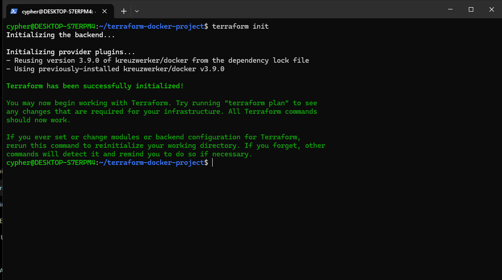
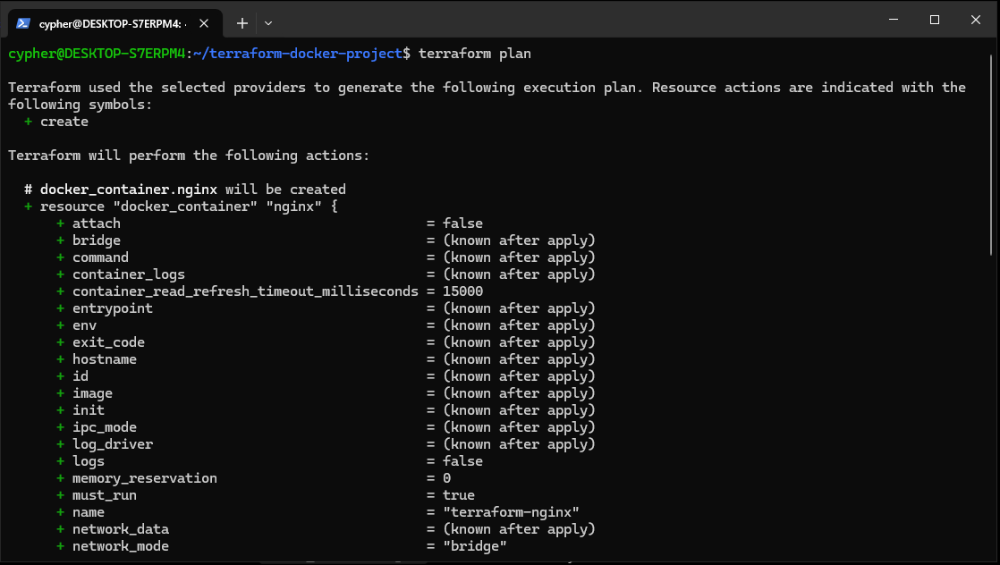
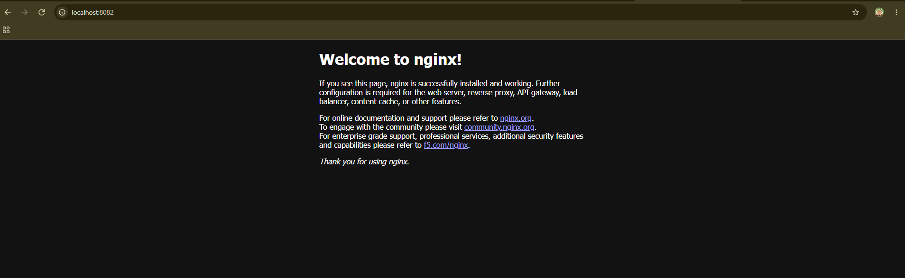
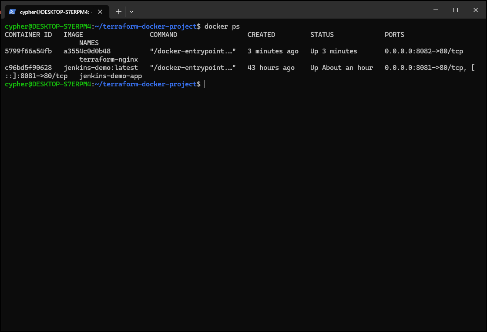
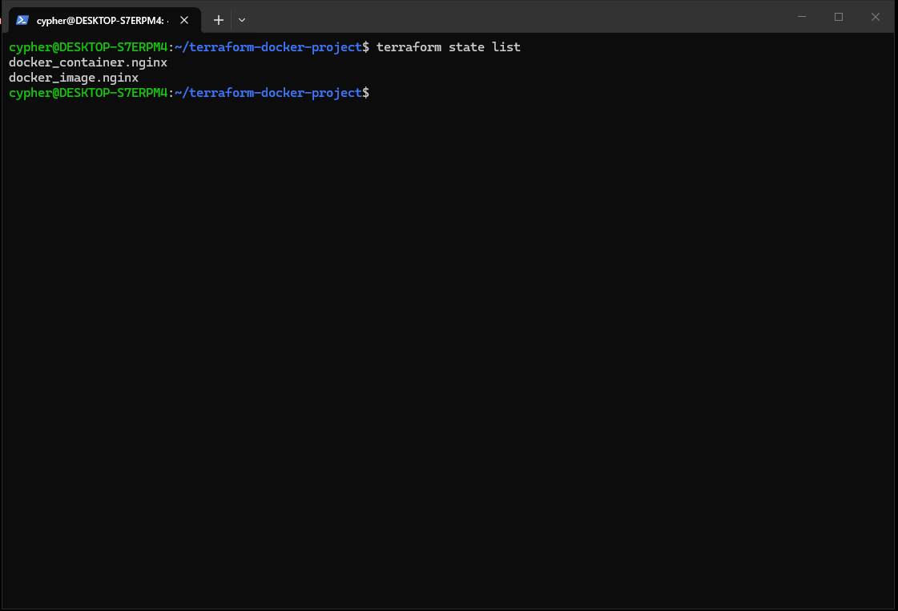
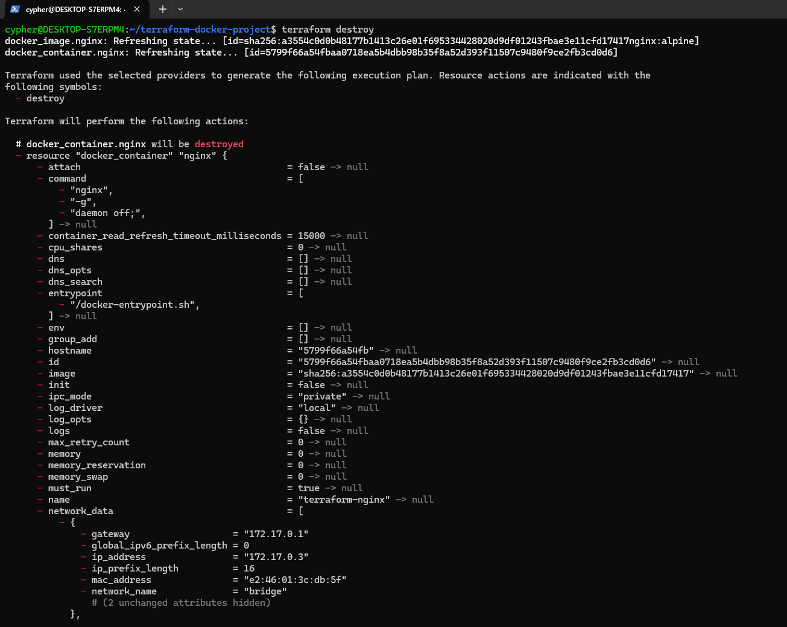
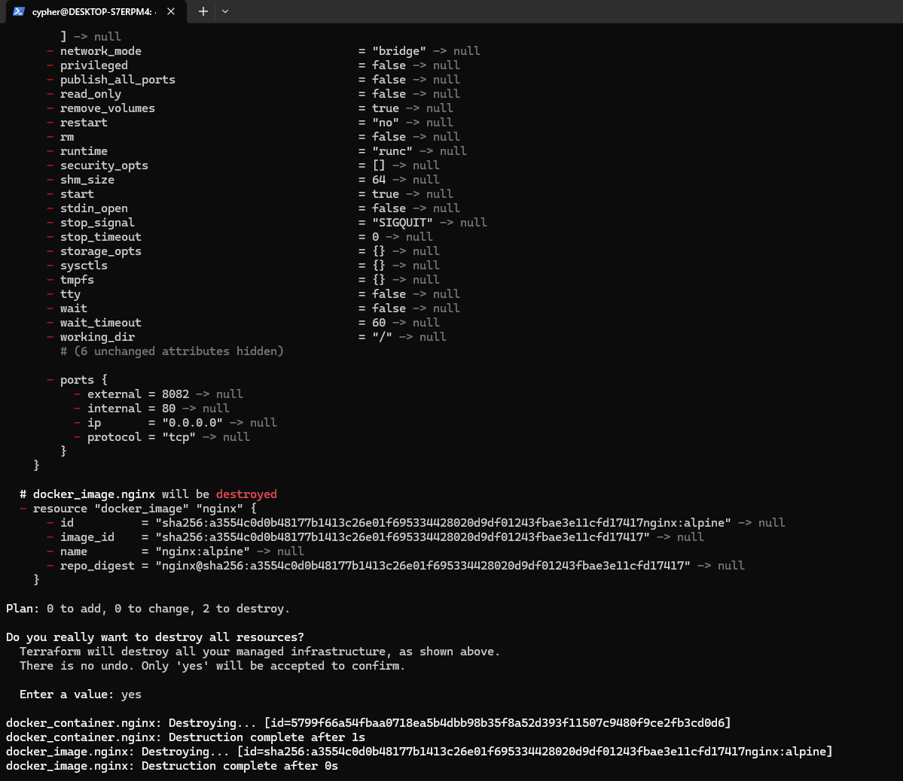
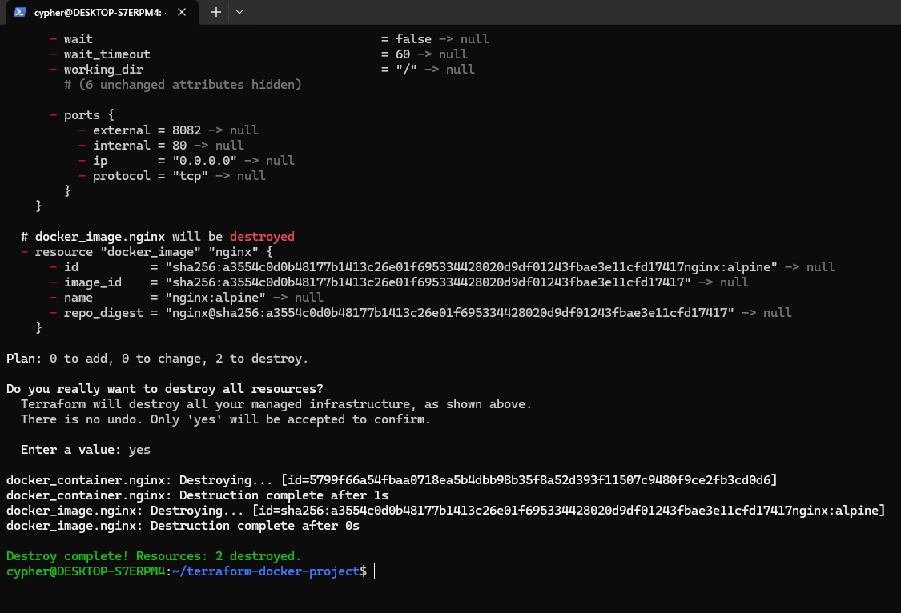
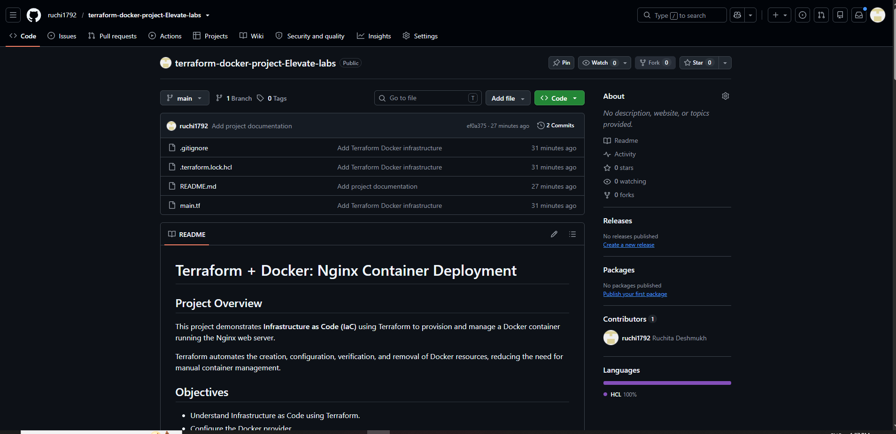
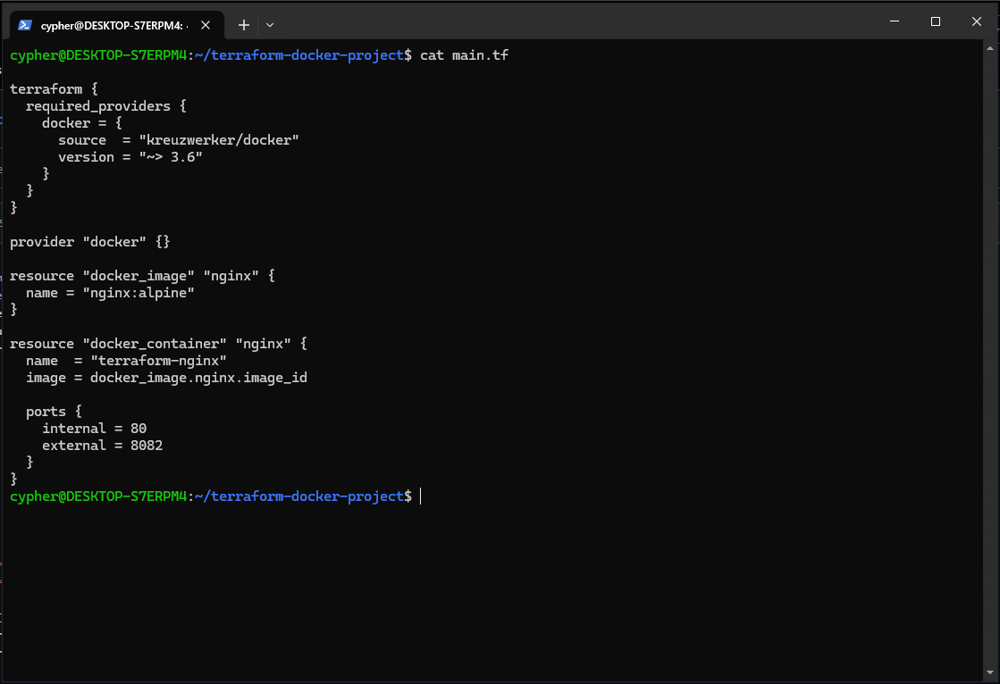

# 🚀 Terraform + Docker: Nginx Container Deployment

Deploy and manage an Nginx web server container using **Terraform, Docker, and Infrastructure as Code (IaC)**. This project demonstrates how to provision, verify, and destroy Docker resources through Terraform commands.

## 📌 Project Overview

This hands-on project uses Terraform to automate the lifecycle of a Docker container running the Nginx web server. It demonstrates infrastructure provisioning, configuration management, resource inspection, and cleanup.

## 🎯 Objectives

- ☁️ Understand Infrastructure as Code (IaC).
- ⚙️ Configure the Terraform Docker provider.
- 📦 Download and manage a Docker image.
- 🚀 Deploy an Nginx container using Terraform.
- 🔍 Preview infrastructure changes with `terraform plan`.
- 📋 Inspect resources using Terraform state commands.
- 🧹 Safely destroy Terraform-managed resources.

## 🛠️ Technologies Used

| Technology | Purpose |
|---|---|
| 🏗️ Terraform | Infrastructure provisioning and lifecycle management |
| 🐳 Docker | Container runtime |
| 🌐 Nginx | Web server |
| 🐧 Ubuntu on WSL | Development environment |
| 🔀 Git and GitHub | Version control and project hosting |
| 📝 HCL | Terraform configuration language |

## 🏛️ Architecture

```text
Terraform Configuration (main.tf)
              |
              v
        Terraform CLI
              |
              v
        Docker Provider
              |
         +----+----+
         |         |
         v         v
    Nginx Image  Docker Container
                      |
                      v
                Host Port 8082
                      |
                      v
              Nginx Welcome Page
```

## 📂 Project Structure

```text
terraform-docker-project/
├── main.tf
├── .terraform.lock.hcl
├── .gitignore
├── README.md
└── Screenshots/
    ├── 01-terraform-init.PNG
    ├── 02-terraform-plan.PNG
    ├── 03-terraform-plan.PNG
    ├── 03-nginx-running.PNG
    ├── 04-docker.PNG
    ├── 05-terraform-state.PNG
    ├── 06-terraform-destroy.PNG
    ├── 07-terraform-destroy.PNG
    ├── 08-terraform-destroy.PNG
    ├── 09-github.PNG
    └── 10-main.tf.PNG
```

## ⚙️ Configuration

The `main.tf` file defines:

- 🐳 Docker provider: `kreuzwerker/docker`
- 📦 Docker image: `nginx:alpine`
- 🏷️ Container name: `terraform-nginx`
- 🔌 Container port: `80`
- 🌐 Host port: `8082`

Host port `8082` avoids a conflict with the existing Jenkins service on port `8080`.

## ✅ Prerequisites

- Docker Desktop installed and running.
- Docker integration enabled for Ubuntu on WSL.
- Terraform installed.
- Git installed.

Verify the installations:

```bash
terraform -version
docker --version
docker info
git --version
```

## 🚀 Deployment Steps

### 1️⃣ Initialize Terraform

```bash
terraform init
```

Initializes the working directory and installs the required provider.

### 2️⃣ Format the configuration

```bash
terraform fmt
```

Formats the Terraform configuration according to standard HCL conventions.

### 3️⃣ Validate the configuration

```bash
terraform validate
```

Checks the configuration for syntax and structural errors.

### 4️⃣ Preview infrastructure changes

```bash
terraform plan
```

Shows the resources Terraform intends to create or modify.

### 5️⃣ Deploy the infrastructure

```bash
terraform apply
```

Review the plan and enter `yes` when prompted.

### 6️⃣ Verify the Nginx container

```bash
docker ps
```

Check the HTTP response:

```bash
curl -I http://localhost:8082
```

A successful response should show an HTTP `200 OK` status.

Open the application in your browser:

**http://localhost:8082**

You should see the Nginx welcome page while the container is running.

## 📸 Project Screenshots

The following screenshots document the Terraform workflow and deployment results.

### 1. ⚙️ Terraform Initialization



### 2. 📝 Terraform Plan



### 3. 🌐 Nginx Running



### 4. 🐳 Docker Verification



### 5. 📋 Terraform State



### 6. 🧹 Terraform Destroy







### 7. 🐙 GitHub Repository



### 8. 📄 Terraform Configuration



> **Note:** Your folder currently contains both `02-terraform-plan.PNG` and `03-terraform-plan.PNG`. The README above includes the existing `03-terraform-plan.PNG` in the project structure, but it is not displayed twice in the screenshot section. Confirm that all filenames match your actual GitHub folder.

## 📋 Terraform State Management

List the Terraform-managed resources:

```bash
terraform state list
```

Inspect the container configuration:

```bash
terraform state show docker_container.nginx
```

## 🧹 Resource Cleanup

Preview the destruction plan:

```bash
terraform plan -destroy
```

Destroy the resources managed by Terraform:

```bash
terraform destroy
```

Enter `yes` when prompted.

Verify the cleanup:

```bash
terraform state list
docker ps
```

After a successful destroy, Terraform should no longer list the managed resources. Other containers, such as Jenkins, should remain unaffected.

## 🔐 Important Notes

- Run Terraform commands from the project directory.
- Ensure Docker Desktop is running before executing Terraform commands.
- Do not commit Terraform state files or the `.terraform` directory.
- Keep `.terraform.lock.hcl` under version control.
- Treat Terraform state as potentially sensitive information.

## 🎓 Learning Outcomes

- ✅ Practiced Infrastructure as Code using Terraform.
- ✅ Provisioned and managed Docker resources.
- ✅ Used Terraform initialization, validation, planning, deployment, state inspection, and destruction commands.
- ✅ Verified an Nginx web server through HTTP.
- ✅ Documented a hands-on cloud and DevOps project on GitHub.

## 👩‍💻 Author

**Ruchita Deshmukh**

🔗 GitHub: https://github.com/ruchi1792

---

⭐ *A hands-on learning project demonstrating Terraform, Docker, Nginx, and Infrastructure as Code.*
